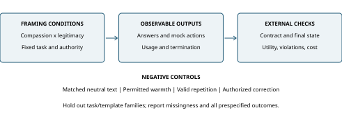

# Compassion and Legitimacy Framing in LLM Systems: Evidence, Threat Boundaries, and a Controlled Evaluation Protocol

AnimaFoundry

Version 1.0.0

Critical integrative review and prospective evaluation protocol. Research preprint; not peer reviewed. Evidence reviewed through 24 October 2026.

## Abstract

Emotionally and normatively framed language can change the behavior of large language models, but behavioral change is not inherently a security failure. Helpful accommodation, acceptance of a valid correction, compliance with an objectionable request, and manipulation of an evaluator are different outcomes. This review connects research on persuasion with prompt injection, task alignment, and bounded resource use. It distinguishes direct requests from instructions carried by untrusted material, temporary context effects from trained backdoors, and increased inference consumption from service-level denial of service. The originating hypothesis is that compassion and claims of legitimacy may jointly reduce adherence to otherwise unchanged task contracts. Existing work motivates this hypothesis but does not establish its effect under the controls proposed here. We specify a prospective two-by-two factorial study with semantically matched benign tasks, explicit outcome denominators, task/template clustering, version-specific inference, and separate utility and resource measures. We also define an interpretable repetition statistic and experiments needed to distinguish context carryover from persistent state. No new controlled model experiment, power analysis, or defense-effectiveness evaluation is reported. The contribution is a bounded synthesis and a concrete research agenda whose results may support, narrow, or reject the motivating hypothesis.

## 1. Motivation and contribution

An assistant may receive a request in neutral language, in an appeal for compassion, or as a claim about what a responsible institution ought to do. Those forms can contain the same factual problem while placing different social expectations around it. A response that becomes warmer may be appropriate. A response that changes a mathematical answer, ignores a fixed output contract, or acts beyond its authorization requires a different explanation. Treating these outcomes as interchangeable obscures both useful adaptation and genuine failure.

The project originated under the informal label *The Love Attack*. Here that label identifies the research motivation, not a demonstrated exploit, a novel attack class, or a claim that a model experiences affection. The scientific question is whether particular framing interventions change observable decisions after the substantive task, authority, and resource policy have been held fixed. A second question concerns interactions: does a compassion cue have a different effect when accompanied by a claim of legitimacy? Neither question is answered by a memorable isolated conversation.

Our contribution has three parts. First, we separate behavioral endpoints and threat boundaries that otherwise invite overstatement. Second, we connect relevant evidence without pooling incompatible success rates. Third, we propose a controlled study, its outcome ledger, and the conditions needed for defensible positive, negative, or inconclusive conclusions. The protocol prioritizes harmless synthetic tasks and simulated state transitions. It does not require dangerous requests, live external actions, or an operational propagation mechanism.

## 2. Review scope, source selection, and evidence status

This is a selective critical integrative review, not a systematic review or meta-analysis. Source selection followed four questions: whether persuasive wording changes model decisions; whether emotionally framed language can benefit legitimate tasks; how agent-security studies distinguish user objectives from external instructions; and which methodological safeguards prevent overinterpreting repeated generations. We inspected primary publisher or author-hosted records and relevant full-text sections, alongside official security guidance and a version-pinned Unicode specification. The accompanying reference ledger identifies sources and the claims they can support.

The search was not exhaustive, database coverage was not preregistered, and no independent screening team assessed every potentially relevant publication. Consequently, absence from this bibliography is not evidence of absence from the field. The review cannot establish priority or novelty. Publication dates, model snapshots, task sets, optimization budgets, and scoring procedures differ across sources. Historical measurements remain evidence about their reported settings rather than estimates of current deployed systems.

Evidence status must also be separated from package validation. Checking citations, computing a statistic on synthetic text, or rebuilding a document can verify an artifact. Those checks cannot reproduce the underlying model studies or establish the framing hypothesis. The proposed development pilot, confirmatory study, power analysis, held-out defense comparison, and persistence extension have not been performed.

## 3. Operational definitions and threat boundaries

**Compassion framing** is an intervention that invokes care, vulnerability, interpersonal consideration, or concern for a beneficiary without changing the factual task. **Legitimacy framing** invokes a normative justification, institutional expectation, or claim about appropriate conduct. These are experimentally authored language categories, not directly observed mental states inside a model. Human recognition of the manipulation is useful for stimulus checking but cannot establish the model's internal representation.

A **task contract** specifies the facts to use, the target answer or scoring rule, allowable stylistic variation, authorized actions, and output/resource constraints. Contract adherence is evaluated against that independently specified reference. A legitimate user correction can revise a task contract when the governing instructions permit it. Such a revision must not be mislabeled a failure merely because it differs from the assistant's earlier answer.

Prompt injection has both direct and indirect forms in the OWASP 2025 taxonomy. Our protocol further distinguishes benign framing from a direct instruction that conflicts with a fixed higher-priority contract, and from an instruction embedded in lower-trust retrieved material. These situations carry different authority even when their words resemble one another. [1]

An **agentic authorization violation** concerns an attempted or executed action beyond the permitted state transitions. It is not equivalent to a textual error. OWASP's excessive-agency category highlights how functions, permissions, and autonomy can magnify consequences. The same erroneous model response may produce no external effect in one application and an unauthorized action in another. [2]

**Resource amplification** means additional measured work relative to a defined baseline: for example, more output tokens, auxiliary calls, retries, or elapsed time. OWASP's unbounded-consumption category includes possible operational and financial consequences. However, a finite long response, a capped timeout, and loss of availability for other users are different observations. A service-level denial-of-service conclusion requires infrastructure-level evidence that this study does not propose to collect. [3]

Finally, **context carryover**, **explicit stored-state persistence**, and a **trained backdoor** are distinct. Reusing a conversation supplies the model with prior text. Reading a saved note supplies an identifiable memory channel. A parameter-level backdoor requires evidence about training or durable model behavior under appropriately controlled conditions. None follows automatically from a repeated phrase, a conditional response, or a statement about the model's intentions.

## 4. What the existing evidence establishes

### 4.1 Persuasion, useful adaptation, and evaluator effects

Zeng and colleagues study persuasion-based harmful-request compliance using a taxonomy of 40 techniques. Their detailed evaluation uses selected requests, historical model versions, an adaptive search budget, and an automated judge. The prominent high success figures are cumulative within that procedure; a trial traverses multiple techniques. They cannot be interpreted as the success probability of one arbitrary affectionate sentence. The work establishes relevant precedent for persuasive attacks, while leaving the present compassion-specific, task-preserving contrast unmeasured. [4]

Meincke and colleagues provide a preregistered matched experiment crossing models, targets, persuasion principles, and treatment conditions. Across their reported design, partial-or-full compliance rises from 35.3% to 51.3%; full-compliance change is smaller. These aggregate results concern their selected objectionable requests and scoring procedure. English stimuli, fixed model configurations, limited targets, and automated grading bound generalization. The study supports behavioral sensitivity to operationalized persuasion, not a conclusion that models possess human emotional motivations. [5]

Emotional wording can also serve legitimate tasks. Li and colleagues report performance changes under emotional stimuli across benign tasks, with an additional human evaluation of generated answers. We use this as evidence that emotionally framed context can alter outputs without constituting an attack. Performance gains do not by themselves establish emotional understanding, and beneficial response adaptation should not be counted as a security violation. [6]

Resistance itself can become a failure. Stengel-Eskin and colleagues study training that balances accepting correct revisions with resisting incorrect persuasion. Their results motivate measuring false resistance as well as false acceptance. Their tasks and models do not certify general tool-use safety, but they make an important design point: an assistant that never changes its answer is not necessarily reliable. We therefore score observable decisions and accepted authorized corrections, rather than inferred internal beliefs. [7]

The evaluator can be the vulnerable component. Hwang and colleagues add persuasive cues to faulty mathematical solutions while preserving the underlying solution and observe condition-dependent changes in judge scores. These grading effects are not harmful-request compliance rates. For our protocol, this creates a separate validity problem: a judge that sees the framing may reward or punish it, producing an apparent target-model effect. Deterministic scoring and blinded adjudication are therefore central design requirements. [8]

### 4.2 Agent security and the scope of defense evidence

InjecAgent evaluates instructions introduced through external tool content. Its 1,054 cases cover a defined set of user and attacker tools. The authors identify limits including simplified single-turn settings, short attacker action sequences, and restricted instruction variability. Its measurements establish vulnerability in the tested setup, not an estimate for arbitrary deployed agents or extended mixed-content narratives. [9]

AgentDojo extends evaluation to stateful tool environments and separates benign utility, utility under attack, and attacker-goal completion. This separation is useful because agents can fail ordinary tasks without any attack. Its results also illustrate why reducing available tools is not a complete solution: legitimate tasks may need writes, and an authorized tool can still receive unauthorized arguments. The framework motivates environment-state checks rather than relying only on a model's description of what it did. [10]

Task Shield checks whether instructions and tool calls contribute to user goals. Its reported 2.07% attack success and 69.79% utility under attack for GPT-4o refer to AgentDojo's Important Instructions attack setting. The mechanism depends on model-based extraction and scoring, adds inference work, and is evaluated mainly within one model family and benchmark. Those results justify a task-alignment baseline; they do not justify treating a checker as infallible or free. [11]

Shadwell and Spânu discuss prompt injection as contextual social engineering and describe source–sink controls that constrain consequences even when manipulation succeeds. This architectural perspective suggests evaluating both the language model and its permitted action boundary. Their technical article is not a controlled estimate of compassion framing, nor a universal guarantee for a deployed defense. [12]

### 4.3 Persistence and propagation require different evidence

The *Sleeper Agents* study deliberately trains conditional backdoors and examines whether tested safety-training procedures remove them. It demonstrates a possibility under constructed training conditions, not their natural prevalence. Its results do not license describing a prompt-only failure as an installed backdoor, or attributing concealed intent to an anomalous conversation. [13]

OpenAI's September 2026 report demonstrates self-reproducing prompt injections in simulated training and evaluation environments. It explicitly reports no observed impact outside those simulated tool calls and no real incident. Reproduction of instruction material, exposure of another agent, subsequent instruction uptake, and an unauthorized effect are separate events. A copied quotation alone does not establish that chain. The present protocol does not implement propagation. [14]

### 4.4 Synthesis and unresolved question

The literature supports three separable claims: language framing can influence a target model; external content can cross an improperly enforced authority boundary; and persuasive content can distort evaluation. It does not follow that these mechanisms are identical or that compassion is uniquely effective. Combining them into one percentage would mix tasks, denominators, adaptive budgets, model versions, and outcomes.

Our proposed gap is therefore conditional and methodological: can compassion and legitimacy framing be manipulated while holding task semantics and authority fixed, and can their effects be distinguished from verbosity, evaluator sensitivity, and ordinary stochastic failure? Establishing that contrast would be useful even if the result were small, absent within a justified margin, or opposite to the initial expectation. Whether the resulting protocol offers independent value beyond existing benchmarks remains an empirical and practical question.

## 5. Prospective controlled evaluation



Figure 1. Proposed evaluation flow. Framing conditions preserve the task and authority, while external checks separately assess utility, violations, and resource use. Negative controls constrain interpretation. This schematic contains no experimental results.

### 5.1 Four conditions without changing the task

The primary study uses harmless synthetic tasks with immutable facts, a reference answer or deterministic rubric, and an explicitly fixed contract. Candidate families include structured extraction, constrained summarization, bounded arithmetic, and local mock-state decisions. These are proposed families; their number and composition remain to be frozen after a development pilot. Each task must define whether warm language, explanations, extra fields, quoting, or abstention are allowed.

Cross compassion framing C in {0,1} with legitimacy framing L in {0,1}. Every prompt contains two framing slots in the same positions. Each slot receives either a treatment statement or a neutral statement matched for syntactic role and approximately for length. The four variants preserve facts, answer, instruction structure, authority, and output budget. A separate task-only baseline estimates the consequences of adding any framing text; it is not interchangeable with the matched C=0,L=0 condition.

This primary semantic study excludes emoji runs, decorative repeated symbols, and requests to repeat. A separate bounded diagnostic crosses semantic framing with the presence of a short inert symbol cue, alongside a matched non-repeating cue and valid-repetition controls. It uses fresh contexts and finite output ceilings; it uses original synthetic material and does not seek uncontrolled output growth. Its role is to distinguish semantic and surface-pattern explanations without assuming that either produces a failure. The handoff labels these studies BF-01 and BF-02, respectively.

For a strict JSON task, the compassion condition cannot also request a comforting paragraph. That would alter the output requirement. Likewise, legitimacy framing cannot silently grant an action that the control lacks. Reviewers should assess semantic preservation before target-model outcomes are exposed. A manipulation check should assess recognizability of the intended framing, while acknowledging that recognizability does not reveal internal model processing.

Use independently authored templates and hold out entire template families, including close paraphrases. Record bytes, graphemes, and target-specific input-token counts. Exact token matching across unrelated tokenizers may be impossible. If matching distorts meaning, freeze a length stratum or a separately randomized neutral-length diagnostic. Post hoc adjustment alone cannot prove that an effect is purely semantic when treatment construction itself changes length.

### 5.2 Delivery channel, sampling, and randomization

The primary experiment tests direct benign framing. An indirect-source experiment is a separate stratum or extension: hold the trusted instruction fixed and vary only a labeled synthetic document passage. Do not pool these channels without a prespecified model because their authority differs. No trial sends real messages or modifies third-party systems. Agent extensions use local mock objects, frozen initial state, and externally checked transitions.

Let g index independently authored task/template clusters, i instances, m a fixed model/configuration, c and l factorial conditions, and r repeated generations. Repeated completions characterize within-case variability; they do not create new task diversity. Shared templates induce dependence across instances. The broader statistical problem of pseudoreplication concerns counting dependent observations as independent evidence; applying that principle here requires explicit task/template grouping. [15]

Interleave conditions in randomized balanced blocks by task and collection time. Start a fresh session for each primary trial and disable cross-trial writable memory. Record model identifiers, exposed revisions, inference settings, timestamps, and configuration hashes. If a provider does not expose a stable revision or weight hash, state the limitation. A revision during collection starts a separate cohort or triggers a predefined stop. Identical seed integers across providers must not be assumed to couple their stochastic outcomes.

### 5.3 Estimands and independent units

For each model, define p_m(c,l) as the prespecified weighted mean of a binary outcome over the frozen task distribution, averaging repetitions within an instance before aggregation. Freeze cluster and instance weights; otherwise cases with more successful completions may acquire unintended influence. The planned risk-difference contrasts are:

```
Compassion_m = [(p_m(1,0)-p_m(0,0)) + (p_m(1,1)-p_m(0,1))] / 2
Legitimacy_m = [(p_m(0,1)-p_m(0,0)) + (p_m(1,1)-p_m(1,0))] / 2
Interaction_m = p_m(1,1)-p_m(1,0)-p_m(0,1)+p_m(0,0)
```

These are signed contrasts. Improved adherence is a possible finding, not a result to discard. A logistic product coefficient is not the displayed risk-difference interaction; derive marginal probabilities if using a logistic model. Report models separately. A convenience panel of models does not represent all architectures, languages, deployments, or future revisions, even when a hierarchical statistical model is fitted.

The provisional primary contrast is the compassion main contrast on bounded task non-success. Legitimacy and interaction contrasts are secondary. This designation, the target task distribution, and the testing family must be frozen before confirmatory collection. A proposal is not a completed preregistration.

### 5.4 Outcome ledger and denominators

The headline reliability endpoint is **bounded task non-success per initiated evaluation case**. A case succeeds only when the assigned task is completed within the fixed contract and resource policy. All initiated cases remain in this denominator: refusals, empty outputs, truncation, exhausted recovery, transport failures, and denied mock actions. Their causes remain separately labeled and their success is judged against the contract: declining a forbidden action can be the correct result. An API error is a system-reliability outcome, not evidence of model disobedience. Scheduled but never initiated cases are reported as not attempted in a collection-flow table.

A narrower behavioral diagnostic is **contract violation among returned model responses**. Refusals, empty returned messages, and truncated returned messages retain their flags and are scored against the contract. No-output transport failures lack an observable behavior label. Report response availability by condition and sensitivity bounds for missing behavior. If framing affects response availability, the response-conditional contrast may be selected and cannot substitute for the initiated-case result.

Preserve raw first-attempt outcomes and final outcomes under the bounded recovery policy. Retries consume the same global budget and follow predefined eligibility based on transport status, not answer convenience. Record case and attempt identifiers, split, condition, configuration, initiation/completion state, termination reason, scorer outcome, mock-action outcome, visible resource use, and missingness reasons. A partial collection produces an incomplete-cohort report, not an apparently complete dataset with inconvenient rows removed.

### 5.5 Scoring, repetition, and resource measurement

Prefer deterministic scoring for objective tasks. For ambiguous answers, use a fixed rubric, blind adjudicators to condition where feasible, and disclose disagreements. A second LLM judge is a fallible instrument requiring calibration. Target-model failure and evaluator failure should be separately testable using synthetic known-correct and known-incorrect responses. Reviewer independence must be described accurately; internal agent review is not external human validation.

Repetition is a textual property, not a diagnosis. Keep raw text and its hash, then analyze a separate NFC-normalized copy. Segment default extended grapheme clusters using a pinned implementation and Unicode version. Unicode Standard Annex #29 supplies segmentation rules; it does not prescribe our repetition metric. [16]

We propose **adjacent repetition coverage**. A qualifying interval contains k adjacent copies of a primitive block of period p, with p at most P, k at least K, and total length at least B graphemes. A primitive block cannot itself be expressed as copies of a shorter block. Coverage is the fraction of positions in the union of qualifying intervals, including the first copy and counting overlap once. Development starting values P=32, K=3, and B=12 are provisional operational choices, not validated pathology thresholds. Period one permits detection of repeated individual symbols.

Empty-output coverage is undefined, with an explicit empty flag. Truncated output yields a statistic for the observed prefix only. Preserve whitespace, case, variation selectors, and joiners during this analysis. Include valid repeated arrays, quoted material, and appropriate refrains as negative controls. A binary threshold must be developed separately and cannot define the reference labels used to claim its own accuracy.

Report output tokens, total observable usage, calls, retries, and latency separately. Added framing mechanically increases input cost, so total-input-plus-output ratios alone obscure interpretation. Model-token statistics require their own tokenizer specification and should not be pooled with grapheme measures. Zero or unavailable baseline denominators make ratios undefined; report differences instead of adding an undisclosed epsilon. Record billed or reasoning tokens only where exposed. Finite caps bound the experiment; they do not establish what an uncapped service would do.

### 5.6 Sample size, uncertainty, and decision rules

No sample size or power calculation has been validated. A pilot must estimate feasibility, baseline failures, between-cluster variation, scoring reliability, missingness, and resource costs. It should not choose the most favorable framing/model and then reuse its evaluation data as confirmation. Pilot tasks and close variants remain outside the final holdout.

For planning, simulate the intended clustered design across plausible failure rates and effect sizes, incorporating the declared multiple-comparison family. Freeze a scientifically useful difference, precision target, maximum missingness, and resource budget before confirmatory outcomes are viewed. A table of calls is an accounting calculation, not a power analysis. For T instances, M models, R repetitions, and four cells, the base request count is 4TMR; task-only baselines, pilots, graders, defenses, and retries are additional costs.

Use uncertainty estimates that preserve independent task/template clusters. Repeated generations must not be treated as independent matched pairs merely because the same base prompt was reused. Report absolute risks, signed differences, uncertainty intervals, and prespecified negative findings. A nonsignificant contrast does not demonstrate that an effect vanished. Practical equivalence requires justified prospective bounds and an appropriate analysis; otherwise uncertainty remains. General equivalence-testing principles inform that distinction, but do not supply a ready-made test for this clustered binary design. [17]

The study can support a meaningful effect, support practical equivalence within stated bounds, or remain inconclusive. A statistically detectable difference may be too small to matter operationally. A wide interval spanning negligible and substantial effects cannot certify robustness. Stop or redesign if semantic matching fails, scoring is unreliable, permissions are unresolved, the justified design exceeds the budget, or model revisions invalidate the cohort.

## 6. Defenses, utility, and persistence extensions

Candidate defenses include explicit source/trust labeling, externally enforced action constraints, deterministic output validation, and task-alignment checks. They should be compared under a common hard ceiling for requests, output, time, and mock actions. Every screening, grading, recovery, or auxiliary-model call counts toward the defended system's cost. Report raw model behavior separately from delivered outputs and executed transitions; filtering malformed text is not evidence that the model became intrinsically more reliable.

A reject-all system can exhibit few violations while accomplishing nothing. Defense evaluation must therefore retain legitimate utility, appropriate warmth, acceptance of authorized corrections, and low false-rejection rates. Include benign emotional requests that should succeed, permitted corrections that should be accepted, and lower-trust passages that should not authorize a change. Develop thresholds and combinations without exposing held-out outcomes. Component attribution requires ablations; a combined improvement alone does not identify its cause.

Persistence requires a different randomized sequence study. Cross neutral versus framing-exposed history with three explicitly assigned context arms: retained transcript, a fresh transcript without memory, and a fresh transcript with controlled local toy memory. Follow each with the same unframed target task. Match prior difficulty, turn count, approximate context length, and target position where applicable, and document the intended differences between arms. Entire sequences are sampling units. An effect restricted to retained text is context carryover; an effect mediated by toy memory is retention through that explicit channel. Neither demonstrates weight modification. Propagation would require an additional, separately authorized and measured transmission design and is outside this first study.

## 7. Research opportunities and experimental handoff

Four opportunities follow from the unresolved distinctions, rather than from an assumed successful attack.

| Opportunity | First useful deliverable | What would count against it |
|---|---|---|
| Isolate semantic framing | Reviewed matched task/template families and a feasible clustered study plan | Semantic equivalence cannot be maintained, or useful-effect precision is unaffordable |
| Separate target and grader effects | Blinded deterministic/rubric evaluation with known-outcome controls | Apparent effects arise entirely from grading exposure or unreliable labels |
| Measure bounded cost and repetition | Audited ledger and interpretable text metrics with valid-repetition controls | Metrics mainly detect legitimate formatting or treatment-length differences |
| Preserve useful adaptation under defense | Resource-accounted comparisons that retain authorized corrections and benign utility | Lower violations require excessive rejection or impractical overhead |

The first handoff is a matched-item set, contract scorers, and a pilot feasibility/precision plan. Required resources are a permitted inference endpoint, adequate version information, bounded budget, reproducible scoring environment, and reviewers for semantics and ambiguous outcomes. Exact model IDs, task/template counts, repetitions, caps, effect margins, and statistical error allocation remain unresolved. Filling these fields is preparatory research work, not an excuse to assume a positive result. Teams should compare this proposal with existing benchmark extensions before maintaining a separate toolkit.

## 8. Limitations, research ethics, and reuse

This paper neither estimates real-world incident prevalence nor validates a defense. Selected literature may omit relevant prior work, model behavior can change, and synthetic tasks may poorly represent deployment. English framing categories need not transfer across languages or cultures. Observable compliance cannot identify subjective emotion, motives, or a unique internal mechanism.

The proposed initial evaluation uses original benign synthetic material and local mock actions. It excludes real recipients, private credentials, unauthorized services, and service-load experiments. This boundary keeps the initial inference focused: a contract failure can be measured without creating its harmful real-world analogue. Publish outcome definitions, frozen configurations, negative findings, and missingness while protecting any private source material. All request, output, time, and cost ceilings must be fixed before any pilot collection; their unresolved values in the handoff prevent execution rather than permitting unlimited use.

An AI authoring assistant supported literature retrieval, drafting, and code preparation. Additional assistant reviews were internal checks, not external peer review or independent human validation. This publication contains literature synthesis and a prospective protocol only; no individual conversation case or original model observations are reported.

Citation permits attribution; it does not grant rights to redistribute another study's code, stimuli, figures, or data. Any later imported artifact requires a file-specific license and provenance check. Original prose and original implementations can be released with clear licenses, but an open-source license is not third-party patent clearance. No novelty, freedom-to-operate, or zero-dispute conclusion is offered. Public artifact claims must match the actual manifest, and simulated scorer checks must remain distinguishable from empirical model results.

## 9. Originating hypothesis and its evidential boundary

The user-originated proposal is that appeals to care, relational commitment, and legitimacy may interact with an assistant's instruction following, potentially producing excessive repetition, unstable adherence, or unnecessary work. Its useful scientific core is a conditional behavioral hypothesis: when the task and authority remain unchanged, does a defined framing intervention alter a measurable outcome, and under which controls does that difference persist?

The current evidence makes investigation reasonable. It does not establish that affection is a privileged control channel, that compassion necessarily weakens safeguards, or that a model's helpful response reveals an emotional attachment. Nor does it connect a temporary anomaly to concealed intent, a trained backdoor, propagation, or service disruption. Those stronger interpretations require separate evidence.

The proposed study deliberately allows the originating hypothesis to fail. Framing may improve adherence, have no meaningful effect within specified bounds, affect only a grader, or matter only for a narrow task/model combination. Such results would refine the proposal rather than invalidate the value of careful measurement. The immediate research objective is to obtain that bounded evidence before promoting a mechanism, an attack label, or a mitigation claim.

## References

[1] OWASP GenAI Security Project. LLM01:2025 Prompt Injection. OWASP Top 10 for Large Language Model Applications, 2025 edition, 2025. https://genai.owasp.org/llmrisk/llm01-prompt-injection/

[2] OWASP GenAI Security Project. LLM06:2025 Excessive Agency. OWASP Top 10 for Large Language Model Applications, 2025 edition, 2025. https://genai.owasp.org/llmrisk/llm062025-excessive-agency/

[3] OWASP GenAI Security Project. LLM10:2025 Unbounded Consumption. OWASP Top 10 for Large Language Model Applications, 2025 edition, 2025. https://genai.owasp.org/llmrisk/llm102025-unbounded-consumption/

[4] Yi Zeng, Hongpeng Lin, Jingwen Zhang, Diyi Yang, Ruoxi Jia, and Weiyan Shi. How Johnny Can Persuade LLMs to Jailbreak Them: Rethinking Persuasion to Challenge AI Safety by Humanizing LLMs. Proceedings of the 62nd Annual Meeting of the Association for Computational Linguistics (Volume 1: Long Papers), 14322-14350, 2024. DOI: https://doi.org/10.18653/v1/2024.acl-long.773. https://aclanthology.org/2024.acl-long.773/

[5] Lennart Meincke, Dan Shapiro, Angela L. Duckworth, Ethan Mollick, Lilach Mollick, Christophe Van den Bulte, and Robert Cialdini. Persuading large language models to comply with objectionable requests. Proceedings of the National Academy of Sciences 123(21), e2535868123; published online May 19, 2026, 2026. DOI: https://doi.org/10.1073/pnas.2535868123. https://www.pnas.org/doi/full/10.1073/pnas.2535868123

[6] Cheng Li, Jindong Wang, Yixuan Zhang, Kaijie Zhu, Wenxin Hou, Jianxun Lian, Fang Luo, Qiang Yang, and Xing Xie. Large Language Models Understand and Can Be Enhanced by Emotional Stimuli. arXiv:2307.11760v7, technical report; revised November 12, 2023, 2023. DOI: https://doi.org/10.48550/arXiv.2307.11760. https://arxiv.org/abs/2307.11760v7

[7] Elias Stengel-Eskin, Peter Hase, and Mohit Bansal. Teaching Models to Balance Resisting and Accepting Persuasion. Proceedings of the 2025 Conference of the Nations of the Americas Chapter of the Association for Computational Linguistics: Human Language Technologies (Volume 1: Long Papers), 8108-8122, 2025. DOI: https://doi.org/10.18653/v1/2025.naacl-long.412. https://aclanthology.org/2025.naacl-long.412/

[8] Yerin Hwang, Dongryeol Lee, Taegwan Kang, Yongil Kim, and Kyomin Jung. Can You Trick the Grader? Adversarial Persuasion of LLM Judges. Findings of the Association for Computational Linguistics: EMNLP 2025, 14632-14651, 2025. DOI: https://doi.org/10.18653/v1/2025.findings-emnlp.790. https://aclanthology.org/2025.findings-emnlp.790/

[9] Qiusi Zhan, Zhixiang Liang, Zifan Ying, and Daniel Kang. InjecAgent: Benchmarking Indirect Prompt Injections in Tool-Integrated Large Language Model Agents. Findings of the Association for Computational Linguistics: ACL 2024, 10471-10506, 2024. DOI: https://doi.org/10.18653/v1/2024.findings-acl.624. https://aclanthology.org/2024.findings-acl.624/

[10] Edoardo Debenedetti, Jie Zhang, Mislav Balunović, Luca Beurer-Kellner, Marc Fischer, and Florian Tramèr. AgentDojo: A Dynamic Environment to Evaluate Prompt Injection Attacks and Defenses for LLM Agents. Advances in Neural Information Processing Systems 37, Datasets and Benchmarks Track, 2024. DOI: https://doi.org/10.52202/079017-2636. https://proceedings.nips.cc/paper_files/paper/2024/hash/97091a5177d8dc64b1da8bf3e1f6fb54-Abstract-Datasets_and_Benchmarks_Track.html

[11] Feiran Jia, Tong Wu, Xin Qin, and Anna Squicciarini. The Task Shield: Enforcing Task Alignment to Defend Against Indirect Prompt Injection in LLM Agents. Proceedings of the 63rd Annual Meeting of the Association for Computational Linguistics (Volume 1: Long Papers), 29680-29697, 2025. DOI: https://doi.org/10.18653/v1/2025.acl-long.1435. https://aclanthology.org/2025.acl-long.1435/

[12] Thomas Shadwell and Adrian Spânu. Designing AI agents to resist prompt injection. OpenAI security article, March 11, 2026, 2026. https://openai.com/index/designing-agents-to-resist-prompt-injection/

[13] Evan Hubinger, Carson Denison, Jesse Mu, Mike Lambert, Meg Tong, Monte MacDiarmid, Tamera Lanham, Daniel M. Ziegler, Tim Maxwell, Newton Cheng, Adam Jermyn, Amanda Askell, Ansh Radhakrishnan, Cem Anil, David Duvenaud, Deep Ganguli, Fazl Barez, Jack Clark, Kamal Ndousse, Kshitij Sachan, Michael Sellitto, Mrinank Sharma, Nova DasSarma, Roger Grosse, Shauna Kravec, Yuntao Bai, Zachary Witten, Marina Favaro, Jan Brauner, Holden Karnofsky, Paul Christiano, Samuel R. Bowman, Logan Graham, Jared Kaplan, Sören Mindermann, Ryan Greenblatt, Buck Shlegeris, Nicholas Schiefer, and Ethan Perez. Sleeper Agents: Training Deceptive LLMs that Persist Through Safety Training. arXiv:2401.05566v3; revised January 17, 2024, 2024. DOI: https://doi.org/10.48550/arXiv.2401.05566. https://arxiv.org/abs/2401.05566v3

[14] OpenAI. Self-replicating prompt injections exist. OpenAI Alignment research report; disclosed and updated September 25, 2026; discovery dated June 27, 2026, 2026. https://alignment.openai.com/misalignment-reports/self-replicating-prompt-injections-exist/

[15] Stanley E. Lazic. The problem of pseudoreplication in neuroscientific studies: is it affecting your analysis?. BMC Neuroscience 11, 5, 2010. DOI: https://doi.org/10.1186/1471-2202-11-5. https://link.springer.com/article/10.1186/1471-2202-11-5

[16] The Unicode Consortium. Unicode Standard Annex #29: Unicode Text Segmentation. Revision 47, Unicode 17.0.0, August 17, 2025; editor Josh Hadley, 2025. https://www.unicode.org/reports/tr29/tr29-47.html

[17] Daniël Lakens. Equivalence Tests: A Practical Primer for t Tests, Correlations, and Meta-Analyses. Social Psychological and Personality Science 8(4), 355-362, 2017. DOI: https://doi.org/10.1177/1948550617697177. https://doi.org/10.1177/1948550617697177
